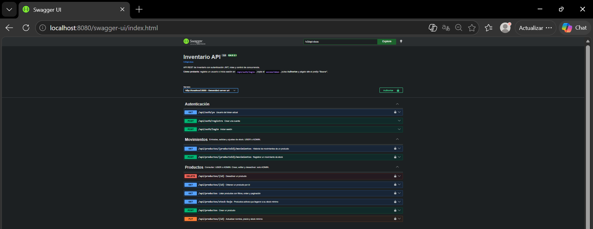
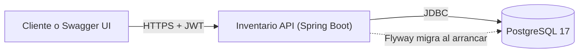
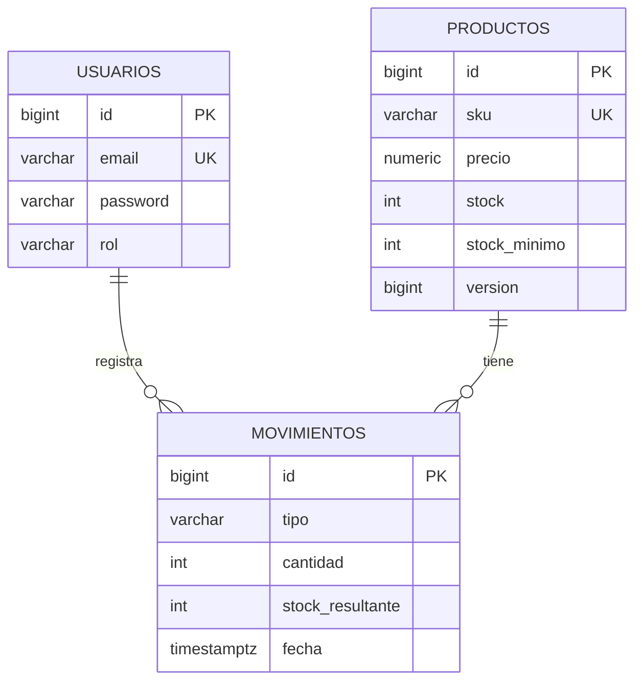
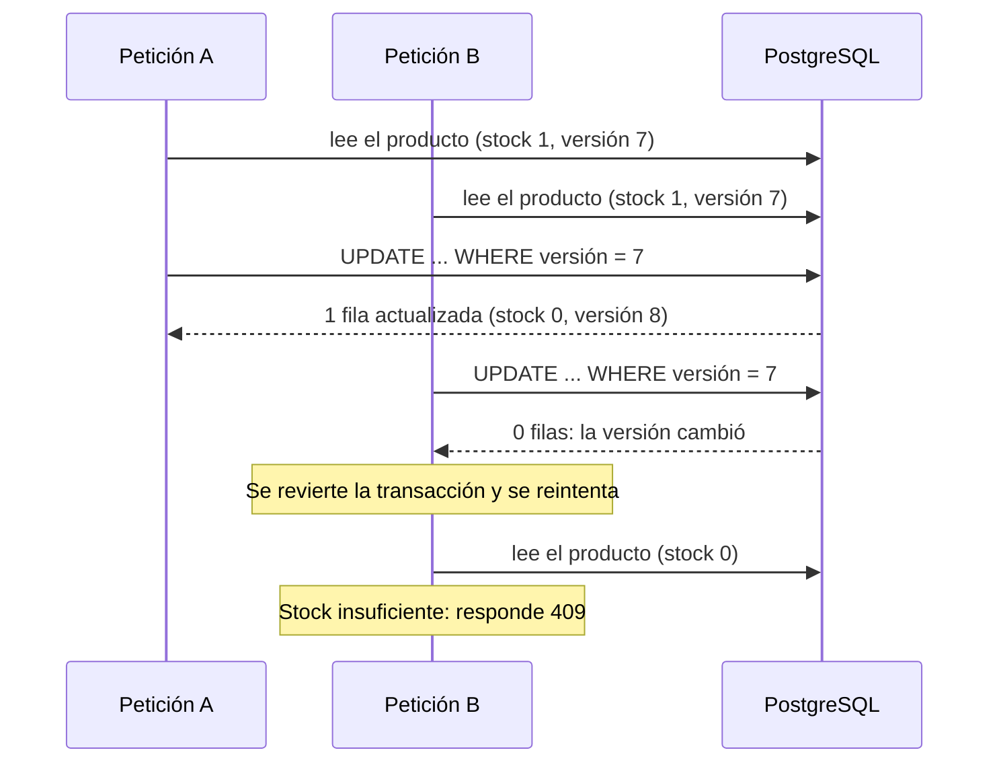
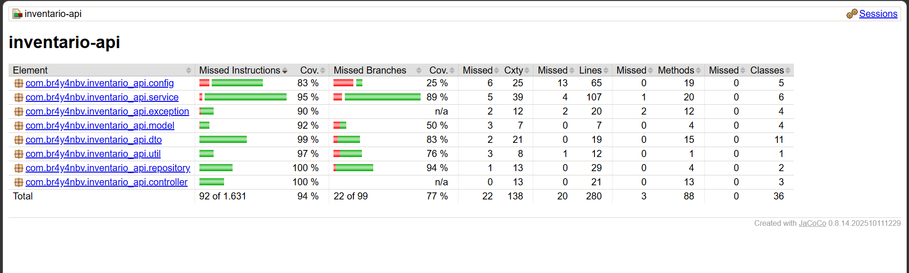

# Inventario API


API REST de inventario con autenticación JWT, roles y control de concurrencia, construida con
Spring Boot 4, PostgreSQL y Docker.



## Qué resuelve

Gestiona un catálogo de productos y su stock. El stock **nunca se edita directamente**: cada
cambio es un movimiento (entrada, salida o ajuste) que queda registrado con el stock resultante,
así el historial siempre explica el estado actual. El stock no puede quedar negativo, ni siquiera
cuando varias ventas del último producto llegan al mismo tiempo.

## Características

- Autenticación con **JWT** (HS256) y dos roles: `ADMIN` gestiona productos; `USER` consulta y registra movimientos
- **Control de concurrencia optimista** (`@Version`) con reintentos acotados
- Esquema versionado con **Flyway** y restricciones `CHECK` en la base de datos como segunda línea de defensa
- Filtros dinámicos, ordenamiento con lista blanca de campos y paginación con tamaño máximo
- Errores en formato estándar **ProblemDetail** (RFC 9457)
- Documentación **OpenAPI/Swagger UI** generada desde el código
- Pruebas unitarias (Mockito) y de integración (**Testcontainers** con PostgreSQL real), con umbral de cobertura (JaCoCo)
- Imagen **Docker** multi-stage, usuario sin privilegios y healthcheck
- **CI** con GitHub Actions: pruebas, cobertura y construcción de la imagen

## Arquitectura



Capas: `controller` (HTTP y documentación) → `service` (reglas de negocio y transacciones) →
`repository` (Spring Data JPA). Las entidades nunca salen por la API: se usan DTOs de entrada y salida.

### Modelo de datos



### Qué pasa cuando dos ventas compiten por la última unidad



Solo una venta se confirma, ninguna se pierde y el stock no queda negativo. Está comprobado con
una prueba que lanza ocho ventas simultáneas.

## Endpoints

| Método | Ruta | Acceso |
|---|---|---|
| POST | `/api/auth/registro` | Público (siempre crea un `USER`) |
| POST | `/api/auth/login` | Público (devuelve el JWT) |
| GET | `/api/auth/yo` | Autenticado |
| GET | `/api/productos`, `/api/productos/{id}`, `/api/productos/stock-bajo` | `USER` o `ADMIN` |
| POST, PUT, DELETE | `/api/productos` | Solo `ADMIN` |
| POST | `/api/productos/{id}/movimientos` | `USER` o `ADMIN` |
| GET | `/api/productos/{id}/movimientos` | `USER` o `ADMIN` |
| GET | `/actuator/health` | Público |

La referencia completa, con ejemplos y códigos de respuesta, está en Swagger UI (`/swagger-ui.html`).
Todos los listados aceptan `page`, `size` (máximo 100), `sort` y `dir`.

## Ejecutar con Docker

Requisitos: Docker y Docker Compose.

```bash
git clone https://github.com/br4y4nbv/inventario-api.git
cd inventario-api
cp .env.example .env     # en PowerShell: Copy-Item .env.example .env
```

Edita `.env`: define `DB_PASSWORD`, una `JWT_SECRET` aleatoria de al menos 32 caracteres
(por ejemplo, `openssl rand -base64 48`) y, si quieres un administrador inicial, `ADMIN_EMAIL` y
`ADMIN_PASSWORD`. Después:

```bash
docker compose -f compose.prod.yaml up --build
```

La API queda en http://localhost:8080 con PostgreSQL y datos persistentes.
`docker compose -f compose.prod.yaml down -v` borra también la base de datos.

## Probarla en un minuto

1. Abre http://localhost:8080/swagger-ui.html
2. En **POST /api/auth/login** inicia sesión con el administrador de tu `.env` y copia el `accessToken`
3. Pulsa **Authorize** y pega el token sin el prefijo "Bearer"
4. Crea un producto, registra una entrada de stock y consulta el historial

Con curl:

```bash
curl -X POST http://localhost:8080/api/auth/login \
  -H "Content-Type: application/json" \
  -d '{"email": "admin@ejemplo.com", "password": "TU_CLAVE"}'

curl http://localhost:8080/api/productos -H "Authorization: Bearer TU_TOKEN"
```

El repositorio incluye `requests.http` con más ejemplos para la extensión REST Client de VS Code.

## Ejecutar en desarrollo

Requisitos: JDK 21 y Docker. Spring Boot levanta PostgreSQL automáticamente desde `compose.yaml`.

```bash
./mvnw spring-boot:run -Dspring-boot.run.profiles=dev
```

El perfil `dev` crea el administrador `admin@inventario.local` con credenciales solo de desarrollo local.

## Pruebas

```bash
./mvnw verify
```

- **Unitarias** (Mockito, sin base de datos): reglas de negocio de los servicios y lógica de reintentos
- **Integración** (Testcontainers con PostgreSQL real): migraciones, API, seguridad con tokens reales y concurrencia
- **Cobertura**: informe en `target/site/jacoco/index.html`; el build falla si la cobertura de líneas baja del 75 %

Requiere Docker en ejecución.



## Decisiones de diseño

- **Movimientos en lugar de editar el stock:** el historial es auditable y cada cambio tiene autor y motivo
- **Bloqueo optimista y no pesimista:** la probabilidad de colisión es baja, no mantiene bloqueos y escala mejor. Con mucha contención sobre un mismo producto convendría un `UPDATE` atómico condicional
- **Reintentos fuera de la transacción:** una transacción que falló por conflicto de versión no se puede reutilizar; cada intento abre una nueva
- **Restricciones en la base de datos y no solo en el código:** el stock negativo es imposible aunque haya un error en la aplicación
- **Borrado lógico de productos:** los movimientos los referencian y el historial debe conservarse
- **Autenticación sin estado:** el token firmado lleva la identidad y el rol, así cualquier instancia puede validarlo
- **Lista blanca para ordenar:** aceptar `?sort=` sin validar permite ordenar por columnas internas y provoca errores 500
- **Sin secretos en el repositorio:** la aplicación no arranca sin `JWT_SECRET` y Compose exige las claves
- **Migraciones con Flyway y `ddl-auto: validate`:** el esquema está versionado y es reproducible

## Limitaciones conocidas y mejoras futuras

- El rol viaja dentro del token: un cambio de rol se aplica cuando el token expira (60 minutos). Una solución completa usaría tokens de vida corta con *refresh tokens*
- No hay límite de intentos de login (*rate limiting*)
- Los reintentos no son idempotentes de cara al cliente; una cabecera `Idempotency-Key` lo resolvería
- Las fechas del historial se interpretan en UTC
- Flyway migra al arrancar, lo cual es simple con una sola instancia; con varias se suele migrar en un paso separado del despliegue

## Licencia

MIT